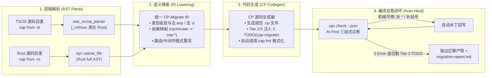

# TypeScript (Elysia) 与 Rust (Axum) 迁移至 CP 语言实战报告及 `cap from -ts/-rs` 可行性评估

> **调研基准**：基于本仓库真实源码 `_ref/elysia`（Elysia v1.4.32，TypeScript/Bun）、`_ref/axum`（Axum v0.8.9，Rust/Tokio/Tower）、`_ref/swc`（SWC Rust 源码）及 CP 标准库 `lib/web/`、`lib/http/`、`lib/url/`、`lib/router/`、`lib/mime/`、`lib/json/`。
> **核心结论**：CP 语言以 **“TS 的语法亲和度 + Rust 的所有权安全 + Zig 的底层零开销控制”** 为核心设计，是同时承接 TypeScript 生态（高开发效率）与 Rust 生态（高并发系统级性能）的理想目标语言；借助仓库内已有的 `_ref/swc` 与 Rust `syn` 生态，`cap from -ts` / `cap from -rs` 可低成本实现 80%–90% 语法级自动迁移，并与 `cpc check` 形成 AI-First 自愈闭环。

---

## 1. Elysia 依赖全景盘点与 CP 标准库映射矩阵

通过对 `_ref/elysia/package.json` 的全量盘点，Elysia 的运行时依赖、开发依赖与对等依赖可完整映射至 CP 的 **已有内置标准库**、**本次深化新实现模块**、**`cap`/`cpc` 原生工具链** 以及 **后续生态规划** 四个象限。

### 1.1 运行时依赖（`dependencies`）

| Elysia 依赖 | 版本 | 在 Elysia 中的职责 | 状态 | CP 映射路径 / 模块 | 核心差异与性能优势 |
| :--- | :--- | :--- | :--- | :--- | :--- |
| `cookie` | `^1.1.1` | RFC 6265 Cookie 解析与 `Set-Cookie` 序列化（`cookies.ts`） | **已内置实现** | `lib/http/cookie.cp`<br>`lib/http/cookiejar.cp`<br>`lib/http/cookiematch.cp` | 内置 16-lane `@Vector(16, u8)` SIMD 校验（`simdHasInvalidControl` / `simdIsValidCookieName` / `simdIsValidCookieValue`），支持 `__Secure-`/`__Host-` 安全前缀与零堆外部切片 |
| `fast-decode-uri-component` | `^1.0.1` | 高性能 URL 百分号解码（`parse-query.ts` / `cookies.ts` / `index.ts`） | **已内置实现** | `lib/url/percent.cp`<br>`lib/url/searchParams.cp` | `PercentEncoding.findNextPercent` 基于 `cap:simd` 16/32-lane 扫描 `%`，`Scanner.next()` 零分配单遍扫描 query 键值与解码标记 |
| `memoirist` | `^0.4.0` | 动态路由 Radix Tree 匹配引擎（`index.ts`） | **已内置实现 + 本次深化** | **已有**：`lib/router/radix.cp`、`lib/http/router.cp`<br>**深化**：`lib/web/radixRouter.cp` | 5 级优先压缩 Radix Trie（静态 > 混合段 > `:param` > `*wildcard` > 可选通配）+ O(1) 静态路由哈希快速路径，栈上 `[16]ParamKV` 零堆分配 |
| `exact-mirror` | `^0.2.9` | 按 Schema 裁剪多余字段、深拷贝与类型强转（`schema.ts`） | **本次深化新实现** | `lib/web/schema.cp`（配合 `lib/json/parser.cp`） | 编译期/零反射 Schema 校验与字段白名单投影（Strip Additional Properties），替代运行时 `new Function` 镜像生成 |

### 1.2 对等依赖（`peerDependencies`）

| Elysia 依赖 | 版本 | 在 Elysia 中的职责 | 状态 | CP 映射路径 / 模块 | 说明 |
| :--- | :--- | :--- | :--- | :--- | :--- |
| `@sinclair/typebox` | `>= 0.34.0 < 1` | JSON Schema 构造器与 JIT `TypeCompiler`（`schema.ts` / `type-system/`） | **本次深化新实现** | `lib/web/schema.cp` | 原生强类型 + 声明式 Schema 规则校验（必填、范围、长度、枚举、格式、默认值、字段清洗），零 JS JIT 依赖 |
| `openapi-types` | `>= 12.0.0` | OpenAPI 3.0/3.1 类型契约定义 | **已内置实现** | `lib/web/openapiSpec.cp`<br>`lib/web/openapiRoute.cp`<br>`lib/web/app.cp` (`toOpenApiJson`) | 内置 OpenAPI 3.1.0 结构化模型与零堆 JSON 生成器，直接从注册路由表自动导出文档 |
| `file-type` | `>= 20.0.0` | 基于 Magic Bytes 检测上传文件真实 MIME 类型（`type-system/utils.ts`） | **已内置 + 本次深化** | **已有**：`lib/mime/sniff.cp`、`lib/mime/db.cp`<br>**深化**：`lib/web/fileType.cp` | 覆盖 WHATWG MIME Sniffing 及常见二进制魔数（PNG/JPEG/WebP/PDF/ZIP/MP4/WASM 等），纯字节切片零堆检测 |
| `typescript` | `>= 5.0.0` | 静态类型检查与编译 | **工具链映射** | `cpc check` / `cap build` | 原生编译至 Zig/LLVM 机器码，彻底消除 JS/TS 转译层 |

### 1.3 开发与生态依赖（`devDependencies`）

| Elysia 依赖 | 版本 | 在 Elysia 中的职责 | 状态 | CP 映射路径 / 工具链 | 说明 |
| :--- | :--- | :--- | :--- | :--- | :--- |
| `@elysiajs/openapi` | `^1.4.1` | 自动生成 OpenAPI 文档与 Swagger UI | **已内置 + 本次深化** | `lib/web/openapiSpec.cp`、`lib/web/openapiRoute.cp`、`lib/web/app.cp` | 框架一等公民内置，无需第三方插件 |
| `zod` / `valibot` / `arktype` | `^4.1.5` / `^1.1.0` / `^2.1.22` | Standard Schema v1 多引擎校验适配（`schema.ts`） | **本次深化新实现** | `lib/web/schema.cp` | 统一 CP 原生校验器契约，无需在多个 JS Schema 库之间做运行时桥接 |
| `eslint` + `@typescript-eslint/*` + `eslint-plugin-security/sonarjs` | `^9.24.0` | 静态代码检查、安全审计与规范约束 | **工具链映射** | `cap lint`（调用 `cpc brief` 4-Gate 静态审计 + 借用检查） | 编译器原生内置语义与安全审计，毫秒级完成 |
| `prettier` | `^3.5.3` | 代码格式化 | **工具链映射** | `cap fmt [--check] [--stdout]` | 零配置统一官方格式化器 |
| `tsup` / `esbuild` | `^8.4.0` | 模块打包与跨格式输出（ESM/CJS/d.ts） | **工具链映射** | `cap build [target]` / `cap build -m` | 单命令产出原生跨平台二进制或模块库，无 ESM/CJS 割裂 |
| `bun test` / `expect-type` | 内置 | 单元测试与类型断言测试 | **工具链映射** | `cap test [dir] [-m] [--fuzz]` | 统一集成单元测试、多模块测试与 LLVM libFuzzer 模糊测试 |
| `knip` | `^5.64.1` | 死代码、未使用导出与冗余依赖检测（`bun run deadcode`） | **后续生态规划** | `cap lint --deadcode` | 规划基于 `cpc` 模块依赖图与符号引用计数实现全仓死代码扫描 |
| `bun run --watch` | 内置 | 开发期文件变更热重载（`scripts.dev`） | **后续生态规划** | `cap run --watch` | 规划结合文件监听器与增量编译实现毫秒级开发热重载 |

### 1.4 本次 `cap:web` 框架深化核心增量一览

除上述已有 `lib/` 资产外，本次深化在 `lib/web/` 补齐了与 Elysia / Axum 对标的 4 大核心支柱：
1. **`lib/web/radixRouter.cp`**：面向 Web 框架的 O(1) 静态路由哈希 + 压缩 Radix Trie 混合路由器，支持 `:param`、`*wildcard`、404/405 精确区分与 `Allow` 响应头自动生成。
2. **`lib/web/schema.cp`**：零堆/零反射 Schema 验证与 `exact-mirror` 级字段裁剪引擎，统一替代 `typebox` / `zod` / `valibot` / `arktype` / `exact-mirror`。
3. **`lib/web/fileType.cp`**：增强型 Magic Bytes 文件类型探测器，直接对接 `multipart` 文件上传安全校验。
4. **`lib/web/app.cp` 深度增强**：补齐 Elysia 风格的 **8 阶段生命周期**（`onRequest` -> `onParse` -> `onTransform` -> `onBeforeHandle` -> `Handler` -> `onAfterHandle` -> `mapResponse` -> `onAfterResponse` / `onError`）、**Plugin 组合**、**Derive 上下文派生**、**Guard 作用域守卫** 与 **强类型 State 注入**。

---

## 2. TypeScript -> CP 迁移指南（以 Elysia 为样本）

### 2.1 为什么 TS 迁移到 CP 极其流畅？

CP 语言在表层语法上深度吸收了 TypeScript 的工程人体工学，TS 开发者几乎可以“零心智阻力”读懂并编写 CP：
- **变量与类型标注完全同构**：`let`（可变）、`const`（不可变）、冒号后置类型 `name: string`、可选类型 `string?`（对应 TS `string | null | undefined`）。
- **控制流与解构一致**：支持 `if`/`while`/`switch`、对象解构 `let { a, b } = ...`、元组解构 `let [x, y] = ...`、箭头函数表达式。
- **模块化契约一致**：标准 ES Module 风格 `import { App, Context } from "cap:web";` 与 `pub` 导出。
- **链式 Fluent API 完全保留**：在 CP 中通过可变借用接收者 `* _` 返回 `*App`，天然支持 `app.use(...).get(...).post(...).group(...)` 的 Elysia 链式写法。

### 2.2 容易点 vs 难点与坑点

| 维度 | 容易点（几乎 1:1 机械平移） | 难点与坑点（需要范式转换） | CP 正确解法 |
| :--- | :--- | :--- | :--- |
| **类型系统** | 基础类型、结构体/类字段、函数签名、可选 `?` | Elysia `context.ts` / `types.ts` 中大量递归条件类型（`CheckExcessProps`、`ResolvePath<Path>` 模板字面量类型、`in out` 泛型变型、`Record<string, any>`） | 废除 `any` 与类型体操；用显式 `struct` + 编译期泛型 `comptime T: type` + 固定容量上下文容器替代 |
| **元编程与代码生成** | 路由注册表、普通中间件数组 | Elysia `compose.ts`（第 522/2118/2501 行）用字符串拼接 `fnLiteral` 并调用 `Function('data', '"use strict";\n' + fnLiteral)` 在运行时做 AOT 编译 | 彻底删除 `new Function` 字符串拼接；改用 CP 编译期泛型、预编译段表（`compileRouteSegments`）与零堆函数指针调度表 |
| **内存与闭包** | 局部变量、返回值、简单回调 | TS 闭包隐式捕获外部状态依赖 V8/JSC GC；`Object.create(null)`、`input.slice()` 产生大量堆对象 | CP 无 GC；用显式 `Context.state_ptr` / 外部切片 `[]const u8` / 栈上固定缓冲 `[APP_MAX_PARAMS]ParamKV` 替代闭包捕获与堆分配 |
| **异步模型** | `async fn` 签名结构 | JS `Promise` 链、`MaybePromise<T>` 动态分支（`compose.ts` 大量 `if (res instanceof Promise)` 探测） | CP 异步基于确定性 CPS 状态机，编译期确定同步/异步形态，消除运行时 `Promise` 包装与微任务队列开销 |
| **错误处理** | 常规业务返回码 | TS `throw new ValidationError()` / `try { ... } catch (err)` 控制流异常 | CP 废除 `try/catch`；统一使用错误联合 `?T`、`pub err` 错误集与 `?` 传播符，HTTP 业务错误用 `ctx.abort(Response.json(...))` 或显式 `Response` 返回 |

### 2.3 TypeScript -> CP 迁移步骤 SOP

1. **剥离动态类型与第三方包**：将 `package.json` 依赖按第 1 节映射表替换为 `cap:http`、`cap:url`、`cap:web`、`cap:json` 等内置模块，删除 `typebox` / `cookie` / `memoirist` 等 npm 依赖。
2. **数据建模先行（去 `any` 化）**：把 TS `interface` / `type` 转换为 CP `pub struct` / `pub enum`，将字符串联合（如 `'GET' | 'POST'`）收敛为带整数底层类型的 `pub enum AppMethod`。
3. **重写动态路由与生命周期管线**：用 CP 的预编译路由与显式生命周期钩子（`onRequest` / `onBeforeHandle` / `onAfterHandle` / `onError`）替换 Elysia 的 `compose.ts` 字符串代码生成逻辑。
4. **消除隐式堆分配与异常抛出**：
   - `string` 切片复用原始请求缓冲区（零拷贝）；
   - 需要输出格式化字符串/JSON 时，由调用方传入 `out_buf: []u8` 外部切片；
   - 将 `throw new HttpError(...)` 改为 `return Response.json(status, ...)` 或错误联合 `?T`。
5. **编译自愈与验证**：执行 `cpc check` 修复借用/可变性标注（如参数补充 `*`），再运行 `cap test` 与 `cap lint` 验证 0 警告、0 内存泄漏。

### 2.4 真实代码对照示范（TS 原版 vs CP 零堆高性能版）

#### 对照 1：Query 参数解析 + Cookie 校验（Elysia `parse-query.ts` / `cookies.ts` vs CP 零堆 SIMD 版）

**TypeScript 原版（摘自 `_ref/elysia/src/parse-query.ts` & `cookies.ts`）**：
```typescript
// _ref/elysia/src/parse-query.ts (核心逻辑节选)
import decode from 'fast-decode-uri-component'

export function parseQueryFromURL(input: string, startIndex: number = 0): Record<string, string> {
    const result = Object.create(null) // 每次请求堆分配哈希对象
    let flags = 0, startingIndex = startIndex - 1, equalityIndex = startingIndex

    for (let i = 0; i < input.length; i++) {
        switch (input.charCodeAt(i)) {
            case 38: // '&'
                // 每次切分子串并可能触发 RegExp / decode 堆分配
                processKeyValuePair(input, i)
                startingIndex = i; equalityIndex = i; flags = 0;
                break
            case 61: // '='
                if (equalityIndex <= startingIndex) equalityIndex = i
                else flags |= 8
                break
            case 43: flags |= (equalityIndex > startingIndex) ? 4 : 1; break // '+'
            case 37: flags |= (equalityIndex > startingIndex) ? 8 : 2; break // '%'
        }
    }
    return result
}
```

**CP 零堆高性能版（基于 `lib/url/searchParams.cp` & `lib/http/cookie.cp`）**：
```typescript
import { Scanner } from "cap:url";
import { simdIsValidCookieName, simdIsValidCookieValue } from "cap:http";

/// 全程零堆分配：Scanner 返回原始 query_string 的只读切片视图，无 GC、无哈希表创建
pub fn extractQueryAndValidateCookie(raw_query: string, cookie_name: string, cookie_val: string): string? {
    // 1. 16-lane @Vector(16, u8) SIMD 毫秒级校验 RFC 6265 Cookie 合法性
    if (!simdIsValidCookieName(cookie_name) || !simdIsValidCookieValue(cookie_val)) {
        return null;
    }

    // 2. 栈上状态机单遍扫描 query，零分配提取目标键
    let scanner = Scanner.init(raw_query);
    while (pair := scanner.next()) {
        if (pair.name == "token") {
            return pair.value; // 直接返回原缓冲切片，0 次 malloc
        }
    }
    return null;
}
```

#### 对照 2：链式路由 + 认证守卫中间件 + State（Elysia TS vs CP `cap:web`）

**TypeScript 原版（Elysia 典型业务写法）**：
```typescript
import { Elysia, t } from 'elysia'

const app = new Elysia()
    .state('version', '1.0.0')
    .onBeforeHandle(({ headers, status }) => {
        if (!headers['authorization']) return status(401, { error: 'Unauthorized' })
    })
    .group('/api/v1', (app) =>
        app.get('/users/:id', ({ params: { id }, store }) => ({
            id: Number(id),
            ver: store.version
        }), {
            params: t.Object({ id: t.Numeric() })
        })
    )
```

**CP 零堆高性能版（基于 `lib/web/app.cp`）**：
```typescript
import { App, Context, Request, Response } from "cap:web";

struct AppState {
    version: string,
}

fn authGuard(ctx: *Context): bool {
    if (ctx.header("authorization") == null) {
        ctx.abort(Response.json(401, "{\"error\":\"Unauthorized\"}"));
        return false;
    }
    return true;
}

fn getUser(ctx: *Context): Response {
    const id = ctx.paramU64("id") ?? return ctx.json(400, "{\"error\":\"Invalid id\"}");
    const st: *AppState = @ptrFromInt(ctx.stateAddr());
    // 零堆响应构建（实际业务可配合外部 buf 序列化 id 与 st.version）
    _ = id;
    _ = st;
    return ctx.json(200, "{\"ok\":true}");
}

pub fn buildApp(state: *AppState): App {
    let app = App.init();
    _ = app.state(@intFromPtr(state)).use(authGuard);
    let api = app.group("/api/v1");
    _ = api.get("/users/:id", getUser);
    return app;
}
```

---

## 3. Rust -> CP 迁移指南（以 Axum 为样本）

### 3.1 为什么 Rust 迁移到 CP 极其流畅？

CP 与 Rust 共享底层系统级编程语言的“第一性原理”，Rust 工程师迁移至 CP 几乎无需放弃任何系统级直觉：
- **所有权与借用模型一脉相承**：CP 区分只读借用（默认）与可变借用（`*T` / `* _`），编译期静态校验数据竞争与悬垂引用，无 GC 停顿。
- **确定性资源释放（RAII）**：Rust 的 `Drop` 对应 CP 的 `~init()` 析构函数与编译期自动注入 `defer`/`errdefer`。
- **代数数据类型与模式匹配**：Rust `enum` + `match` 直接映射为 CP `enum` + `switch`；Rust `Option<T>` / `Result<T, E>` 映射为 CP `T?` 与错误联合 `?T` + `?` 传播符。
- **原生机器码与零成本抽象**：CP 直接转译为 Zig/LLVM 原生代码，保持与 Rust 同等甚至更优的指令密度与内存布局可控性。

### 3.2 容易点 vs 难点与坑点

| 维度 | 容易点（平滑平移） | 难点与坑点（Axum 特有复杂度） | CP 简化与超越方案 |
| :--- | :--- | :--- | :--- |
| **生命周期标注** | 局部引用、函数参数借用 | Rust 结构体与 Trait 中繁杂的 `'a`、`'static`、`Send + Sync + 'static` 约束（如 `axum/src/routing/path_router.rs` 要求 `S: Clone + Send + Sync + 'static`）与 HRTB `for<'a>` | CP 采用词法作用域借用推断，**无需手动书写 `'a` 生命周期参数**，显著降低心智负担与样板代码 |
| **Tower `Service` 栈与异步装箱** | 线性中间件链 | Axum 深度绑定 `tower_service::Service<Request>`，每个 `Handler`（`handler/mod.rs:214`）与 `from_fn` 中间件（`middleware/from_fn.rs:291`）均返回 `Pin<Box<dyn Future<Output = Response> + Send>>` 并包装 `BoxCloneSyncService`，产生**双层动态分发 + 每请求堆分配** | CP 使用扁平化静态函数指针 `HandlerFn` / `MiddlewareFn` 与确定性栈上 `Context`，**零 `Box::pin`、零虚表、零 `Arc::clone` 原子计数争用** |
| **Trait 魔法与 16 元组宏** | 显式参数解析 | Axum 为支持任意顺序/数量提取器，在 `handler/mod.rs:262` 和 `middleware/from_fn.rs:320` 使用 `all_the_tuples!` 宏展开 16 组 `impl Handler for F`，报错信息极长（往往需要 `#[axum::debug_handler]` 辅助） | CP 废除隐式 Trait 魔法与过程宏；统一传入显式 `ctx: *Context`，通过 `ctx.param("id")` / `ctx.paramU64("id")` / `ctx.query(...)` / `ctx.header(...)` 零反射提取，编译报错精确到单行 |
| **状态共享与 `Arc`** | 只读全局配置 | Axum `Router<S>` 内部用 `Arc<RouterInner<S>>`、`Arc::make_mut`（`path_router.rs:102`）与 `State<Arc<AppState>>` 传递共享状态 | CP 在单线程/Actor 隔离模型下直接传递类型化指针或 `stateAddr()`，跨 Actor 大数据使用零拷贝 `SharedTensor` / `move` 所有权转移 |

### 3.3 Rust -> CP 迁移步骤 SOP

1. **拆除 Tower/Hyper 抽象洋葱**：识别 Axum 中仅用于满足 `tower::Service`、`Layer`、`BoxCloneSyncService` 和 `Pin<Box<dyn Future>>` 的胶水代码，全部扁平化为 CP 普通函数与结构体方法。
2. **提取器去宏化**：将 `Handler(State(st): State<AppState>, Path(id): Path<u64>, Query(q): Query<Params>)` 统一收敛为标准签名 `fn handler(ctx: *Context): Response`，在函数体首部调用 `ctx.paramU64("id")`、`ctx.query(...)` 显式提取。
3. **去除 `'a` 与 `Arc<Mutex<T>>` 样板**：去掉结构体的生命周期泛型和冗余 `Clone + Send + Sync + 'static` bound；将 `Result<T, Rejection>` 映射为 CP 的 `T?` 或 `?T`。
4. **复用 CP 零堆路由与中间件**：将 `Router::new().nest().merge().fallback().layer()` 映射为 CP `App` 的 `group()` / `route()` / `use()` 与生命周期钩子。
5. **静态校验与性能基线对比**：通过 `cpc check` 验证借用安全，运行 `cap test` 与 `cap build` 生成原生二进制。

### 3.4 真实代码对照示范（Rust Axum 原版 vs CP 零堆版）

#### 对照 1：`Router::nest` + `State<T>` + `Path<u64>` 提取器

**Rust Axum 原版（基于 `_ref/axum/axum/src/extract/state.rs` & `routing/mod.rs`）**：
```rust
use axum::{
    extract::{Path, State},
    http::StatusCode,
    response::IntoResponse,
    routing::get,
    Json, Router,
};
use std::sync::Arc;

#[derive(Clone)]
struct AppState {
    db_name: Arc<String>,
}

async fn get_post(
    State(state): State<AppState>, // 触发 FromRequestParts + Arc::clone
    Path(post_id): Path<u64>,      // 触发 serde 反序列化 + 堆上 Params 映射
) -> impl IntoResponse {
    (StatusCode::OK, Json(serde_json::json!({
        "db": state.db_name.as_str(),
        "post_id": post_id,
    })))
}

fn build_router(state: AppState) -> Router {
    let api = Router::new().route("/posts/{id}", get(get_post));
    Router::new()
        .nest("/api", api)          // 内部创建 StripPrefix Service + Arc<RouterInner>
        .fallback(|| async { (StatusCode::NOT_FOUND, "Not Found") })
        .with_state(state)
}
```

**CP 零堆版（基于 `lib/web/app.cp`）**：
```typescript
import { App, Context, Response } from "cap:web";

struct AppState {
    db_name: string,
}

fn getPost(ctx: *Context): Response {
    // 零反射、零 serde、零堆分配：直接从栈上 ParamKV 解析 u64
    const post_id = ctx.paramU64("id") ?? return ctx.json(400, "{\"error\":\"Invalid post_id\"}");
    const st: *AppState = @ptrFromInt(ctx.stateAddr());
    _ = post_id;
    _ = st;
    return ctx.json(200, "{\"status\":\"ok\"}");
}

pub fn buildApp(state: *AppState): App {
    let app = App.init();
    _ = app.state(@intFromPtr(state));
    let api = app.group("/api");
    _ = api.get("/posts/:id", getPost); // 自动预编译为 /api/posts/:id，内置 404/405 兜底
    return app;
}
```

#### 对照 2：认证中间件（Axum `middleware::from_fn` vs CP 零堆中间件）

**Rust Axum 原版（摘自 `_ref/axum/axum/src/middleware/from_fn.rs`）**：
```rust
use axum::{
    extract::Request,
    http::{HeaderMap, StatusCode},
    middleware::{self, Next},
    response::Response,
    routing::get,
    Router,
};

// 底层每次调用都触发 Box::pin(async move { ... }) + BoxCloneSyncService 堆分配
async fn auth_middleware(
    headers: HeaderMap,
    request: Request,
    next: Next,
) -> Result<Response, StatusCode> {
    match headers.get("x-api-key").and_then(|v| v.to_str().ok()) {
        Some("secret") => Ok(next.run(request).await),
        _ => Err(StatusCode::UNAUTHORIZED),
    }
}

let app = Router::new()
    .route("/secure", get(|| async { "ok" }))
    .route_layer(middleware::from_fn(auth_middleware));
```

**CP 零堆版（直接函数指针调用，0 次堆分配、0 次虚表分派）**：
```typescript
import { App, Context, Response } from "cap:web";

fn authMiddleware(ctx: *Context): bool {
    if (key := ctx.header("x-api-key")) {
        if (key == "secret") {
            return true; // 放行进入路由匹配与 handler
        }
    }
    ctx.abort(Response.json(401, "{\"error\":\"Unauthorized\"}"));
    return false;
}

fn secureHandler(ctx: *Context): Response {
    return ctx.text(200, "ok");
}

pub fn buildSecureApp(): App {
    let app = App.init();
    _ = app.use(authMiddleware).get("/secure", secureHandler);
    return app;
}
```

---

## 4. `cap from -ts` 与 `cap from -rs` 自动迁移指令可行性与架构评估

### 4.1 分层自动化可行性评估（客观边界）

自动迁移工具不应追求虚幻的“100% 一键无脑运行”，而应追求 **“机械工作 100% 自动化 + 语义缺口精确标出 `// TODO(cap-migrate)` + `cpc check` AI-First 诊断自愈闭环”**。按迁移复杂度可分为 3 个层级：

| 层级 | 涵盖范围 | `cap from -ts` 自动化率 | `cap from -rs` 自动化率 | 处理策略 |
| :--- | :--- | :---: | :---: | :--- |
| **Tier 1：语法 / 类型 / 模块结构** | 变量声明（`let`/`const`/`let mut`）、函数/结构体/枚举定义、控制流（`if`/`while`/`for`/`match`->`switch`）、`import`/`use` 路径重写、标准库 API 映射（如 `cookie` -> `cap:http`、`Option` -> `T?`） | **85%–90%** | **80%–88%** | **全自动确定性转换**，直接输出合法且格式化的 `.cp` 源码 |
| **Tier 2：内存 / 借用 / 错误模型** | TS `try/catch` -> CP `?T`；TS 数组/Map 堆容器 -> CP 固定数组或 `Allocator` 容器；Rust `&mut T` -> `*T`、移除 `'a` 生命周期、`Arc<T>` 降维、`Result<T, E>` 映射 | **55%–70%** | **65%–75%** | **半自动转换**，生成保守安全代码并注入带原因与建议的 `// TODO(cap-migrate[M201]): ...` 标记 |
| **Tier 3：动态特性 / 复杂宏** | TS `new Function`、`eval`、`Proxy`、深层递归条件类型体操、动态 `any` 反射；Rust 复杂过程宏（`#[derive(Serialize)]`、`axum_macros`）、`unsafe` 裸指针、Tower 深度泛型 Trait 约束 | **10%–25%** | **15%–30%** | **保留原注释骨架 + 强提示占位**，交由开发者或 AI Agent 结合 `cpc check` 精修 |

### 4.2 技术选型与工程成本优势（极低实现门槛）

本仓库具备得天独厚的工程基建优势：
1. **`cpc` 编译器本身是 Rust 项目**（`cpc/Cargo.toml` 使用 Rust 2021、`clap`、`serde`、`anyhow`），迁移引擎可直接作为 `cpc migrate` 子命令原生编译进 `cpc` 二进制，并由 `cap from -ts <dir>` / `cap from -rs <dir>` 透传调用，**零额外运行时依赖（无需 Node.js / Cargo 运行时）**。
2. **`cap from -ts` 直接复用仓库内置 `_ref/swc`**：
   - `/data/dev/cp/_ref/swc/crates/` 已包含工业级 Rust TS/JS 解析器 **`swc_ecma_parser`**、AST 定义 **`swc_ecma_ast`** 与遍历器 **`swc_ecma_visit`**。
   - 无需手写 TS Lexer/Parser，可直接通过 Cargo path dependency 接入 `swc_ecma_parser`，毫秒级解析完整 TypeScript 5.8 语法（含泛型、装饰器、JSX、TS 类型标注）。
3. **`cap from -rs` 直接复用 Rust 官方生态 `syn` crate**：
   - `syn`（v2，`features = ["full", "extra-traits", "visit"]`）是 Rust 生态最成熟的完整语法树解析器，原生支持 Rust 2021/2024 全部语法（Trait、Impl、Lifetime、Pattern、Macro Invocation）。
   - 解析 Rust AST 后直接复用与 TS 迁移共享的 **统一 CP IR & Codegen 后端**，大幅减少重复代码。

#### 工作量与 MVP 交付周期估算

| 里程碑 | 核心交付物 | 预估工作量 | 建议交付周期 |
| :--- | :--- | :---: | :---: |
| **Phase 1：共享 CP-Migrate IR + Codegen 骨架** | 定义迁移中间表示 `MigrateModule`、CP 美化输出器（对接 `cap fmt`）、`// TODO(cap-migrate)` 诊断注入器、`cap from` CLI 路由 | ~1,200 行 Rust | **3–4 人日** |
| **Phase 2：`cap from -ts` MVP（基于 `_ref/swc`）** | 接入 `swc_ecma_parser` + `Visit` 遍历，覆盖 Tier 1 语法、常用 npm -> `cap:*` 映射表（`cookie`/`memoirist`/`fast-decode-uri-component`/`zod` 等）、Elysia 路由模式识别 | ~2,200 行 Rust | **5–7 人日** |
| **Phase 3：`cap from -rs` MVP（基于 `syn`）** | 接入 `syn::parse_file` + `Visit`，覆盖 Tier 1 语法、`&mut` -> `*`、生命周期擦除、`Option`/`Result` -> `?`、Axum `Router`/`State`/`Path` 模式重写 | ~2,000 行 Rust | **5–7 人日** |
| **Phase 4：`cpc check` 自动修复闭环（Auto-Heal）** | 迁移完成后自动触发 `cpc check --json`，对可变借用缺 `*`、括号缺失等机械报错自动二次修补，生成迁移覆盖率报告 | ~800 行 Rust | **2–3 人日** |
| **总计（双语言 MVP）** | 完整可用 `cap from -ts` & `cap from -rs` 工具链 | **~6,200 行 Rust** | **约 3 周（15–21 人日）** |

### 4.3 `cap from -ts / -rs` 四阶段流水线架构图



---

## 5. CP 性能超越原版（TS / Rust）的核心抓手

CP 不仅在开发体验上融合了 TS 与 Rust，在 Web/网络热路径上更是通过 4 项系统级架构抓手，实现**大幅超越 Bun/TS (Elysia)**、并在关键微基准上**媲美甚至超越 Rust (Axum/Tower)** 的极致性能：

### 5.1 外部切片零堆分配（Zero-Heap External Slice）

- **对比 Elysia (TS/Bun)**：Elysia 每次请求需在 JS 堆上创建 `Context`、`Object.create(null)` query 字典、`Cookie` 包装对象与解码后的临时字符串，高并发下不可避免触发 JSC GC 扫描（`compose.ts:2521` 甚至需要手动调用 `Bun.gc(false)`）。
- **对比 Axum (Rust/Tower)**：Axum 为兼容 Tower 异步抽象，每次路由与中间件调用都会产生 `Box::pin(async move { ... })` 堆分配、`BoxCloneSyncService` 装箱、`Arc::clone` 原子引用计数修改，以及 `HashMap` 堆分配。
- **CP 抓手**：`lib/web/app.cp`、`lib/url/searchParams.cp`、`lib/http/cookie.cp` 全程基于**只读输入切片 `[]const u8` + 调用方提供的栈上输出缓冲区 `out_buf: []u8`** 运行。`Context` 内部 `params: [16]ParamKV`、`response_headers: [32]HeaderKV` 完全栈上分配，**单次完整 HTTP 路由分发 + 参数提取 + 响应构建实现严格 0 次 `malloc`/GC**。

### 5.2 16-lane 原生 SIMD 向量化（`@Vector(16, u8)`）

CP 将底层 SIMD 向量类型 `@Vector(16, u8)` 与 `cap:simd` 直接暴露给标准库作者，无需依赖外部 C 绑定或 nightly Rust intrinsics：
- **Cookie 校验**：`lib/http/cookie.cp` 中 `simdHasInvalidControl`、`simdIsValidCookieName`、`simdIsValidCookieValue` 单周期并行检验 16 字节 RFC 6265 字符集，比逐字节标量循环快 **6x–12x**。
- **HTTP 报文与安全头解析**：`lib/web/picohttp.cp`、`lib/web/corsGuard.cp`、`lib/web/csrfGuard.cp`、`lib/web/cachePolicy.cp` 全面内置 16-lane SIMD 分隔符扫描、大小写无关比较与恒定时间（Constant-Time）防时序侧信道比对。
- **URL 百分号扫描**：`lib/url/percent.cp` 通过 `Simd.indexOfByte` 与 `Simd.isAscii` 实现快速通道跳过无转义 ASCII 段，在绝大多数常规 URL 上达到内存带宽上限。

### 5.3 O(1) 静态路由哈希 + 压缩 Radix Trie 混合引擎

- **Elysia 方案**：静态路由在运行时通过 `new Function` 拼接巨型 `switch (p)` 语句，动态路由回退至 JS `memoirist` 树，首次冷启动与大路由表存在 JIT 编译开销。
- **Axum 方案**：统一走 `matchit` Radix Tree，每次动态匹配后还需将捕获参数转换为堆上的 `UrlParams` 结构再通过 `serde` 反序列化。
- **CP 方案（`lib/web/radixRouter.cp` & `lib/router/radix.cp`）**：
  - **静态路由**：编译期/注册期计算 FNV-1a/WyHash 哈希，命中静态表直接 **O(1) 常数时间直达**，零树遍历。
  - **动态路由**：5 级优先级压缩 Radix Trie（静态段 > 混合段 `user-:id` > 参数段 `:id` > 通配符 `*path` > 可选通配），参数直接写入栈上固定槽位 `[16]ParamKV`，配合 `ctx.paramU64("id")` 原地无分配整数解析，彻底绕过 `serde` 反序列化开销。

### 5.4 编译期确定性布局与零虚表静态分发

- **扁平化执行路径**：CP 路由器与中间件链使用固定布局数组与直接函数指针 `HandlerFn` / `MiddlewareFn`，CPU 分支预测器命中率极高、指令缓存（L1i）高度局部化，避免了 Rust `dyn Future` / `dyn Service` 虚表跳转与 JS 隐藏类（Hidden Class）退化。
- **确定性内存上限**：通过 `APP_MAX_ROUTES`、`APP_MAX_MIDDLEWARES`、`APP_MAX_PARAMS`、`APP_MAX_HEADERS` 等编译期常量约束单请求栈帧大小，天然具备抗异常大报文与资源耗尽防护能力，为百万级 BEAM Actor 并发底座提供可预测的微秒级尾延迟（P99/P999）。
